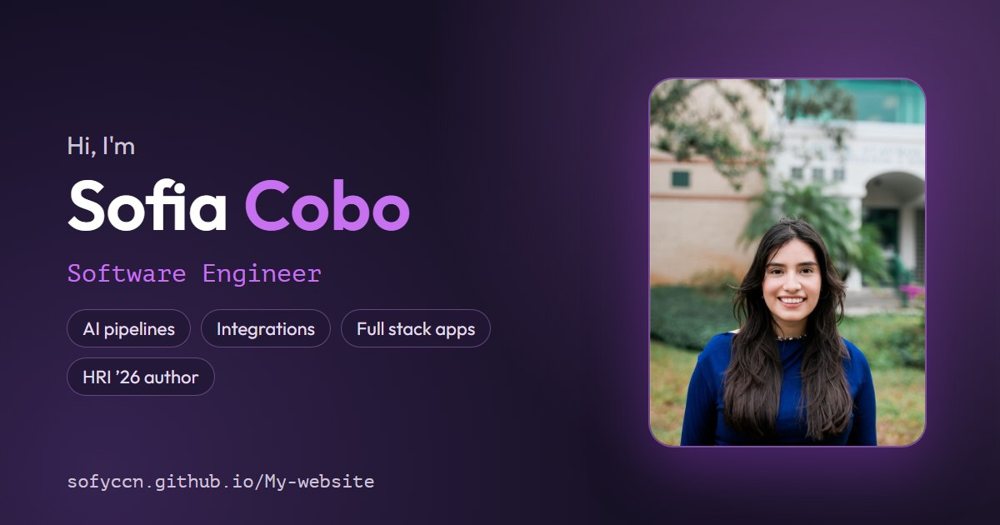

# Sofia Cobo — Portfolio

**Live site:** https://sofyccn.github.io/My-website/

My personal portfolio. I'm a software engineer building AI pipelines, integrations, and full stack web apps, and a Computer Science graduate from the University of South Florida.



## What's on the site

- **Home** — who I am, what I'm open to, and highlights: a paper published at ACM/IEEE HRI ’26, 1st place at HealthHacks USF, a USF Undergraduate Research Award, and a +30% lift in reported sales from an app I built.
- **Projects** — case studies for my featured work (an AI sales call analysis pipeline, the Kyodo Catalog B2B app, and the Bloom social robot), each covering the problem, my role, how it works, and the results. Below them is a grid of other projects.
- **About** — work experience, education, skills, and my GitHub contribution calendar.
- **Resume** — an in-browser view of my resume with a download link.

## Built with

- React 17 with React Router, built with Create React App
- React Bootstrap and custom CSS
- react-pdf for the resume viewer, loaded only when the Resume page opens
- Deployed to GitHub Pages by a GitHub Actions workflow

## Run it locally

You need Node.js 18 or newer.

```bash
git clone https://github.com/sofyccn/My-website.git
cd My-website
npm install
npm start
```

The site opens at http://localhost:3000/My-website.

## Deployment

Every push to `main` runs [`.github/workflows/deploy.yml`](.github/workflows/deploy.yml). The workflow builds the app and publishes the `build` folder to GitHub Pages.

It also copies `index.html` to `404.html`, so pages like `/about` still load when opened directly or refreshed. In the repo's **Settings → Pages**, the source must be set to **GitHub Actions**.

## Where things live

| To change | Edit |
|---|---|
| Featured case studies | `src/components/Projects/caseStudies.js` |
| Other project cards | `src/components/Projects/Projects.js` |
| Work experience and education | `src/components/About/Experience.js` |
| Skills | `src/components/About/Techstack.js` |
| Home intro and highlights | `src/components/Home/Home.js` and `Home2.js` |
| Resume PDF | `src/Assets/sofia_resume.pdf` |
| Link preview image | `public/og-image.jpg` |

## Contact

- Email: sofycobo14@gmail.com
- LinkedIn: [linkedin.com/in/sofia-cobo](https://www.linkedin.com/in/sofia-cobo/)
- GitHub: [@sofyccn](https://github.com/sofyccn)
